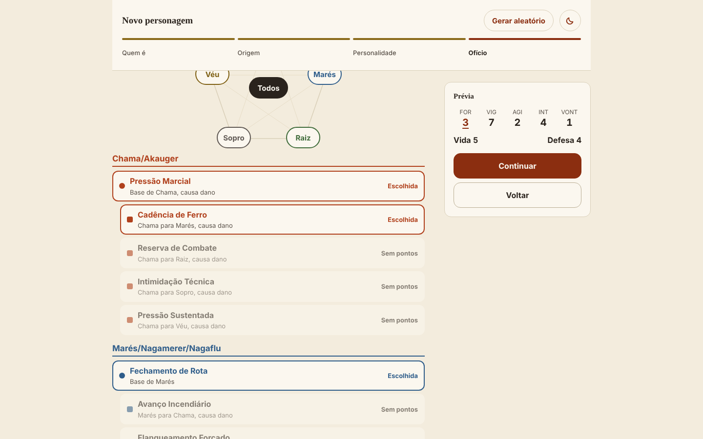
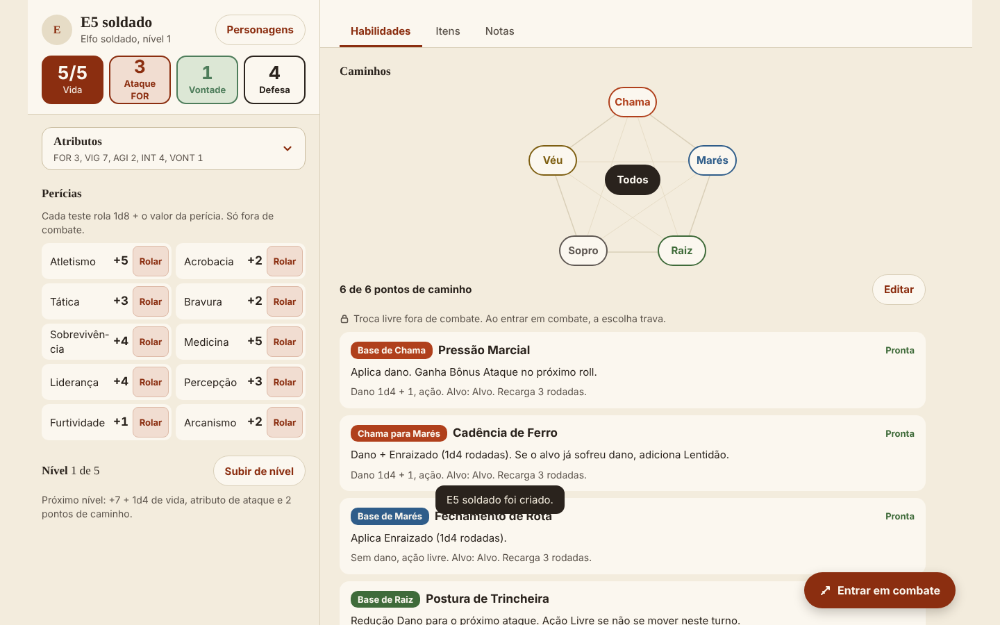
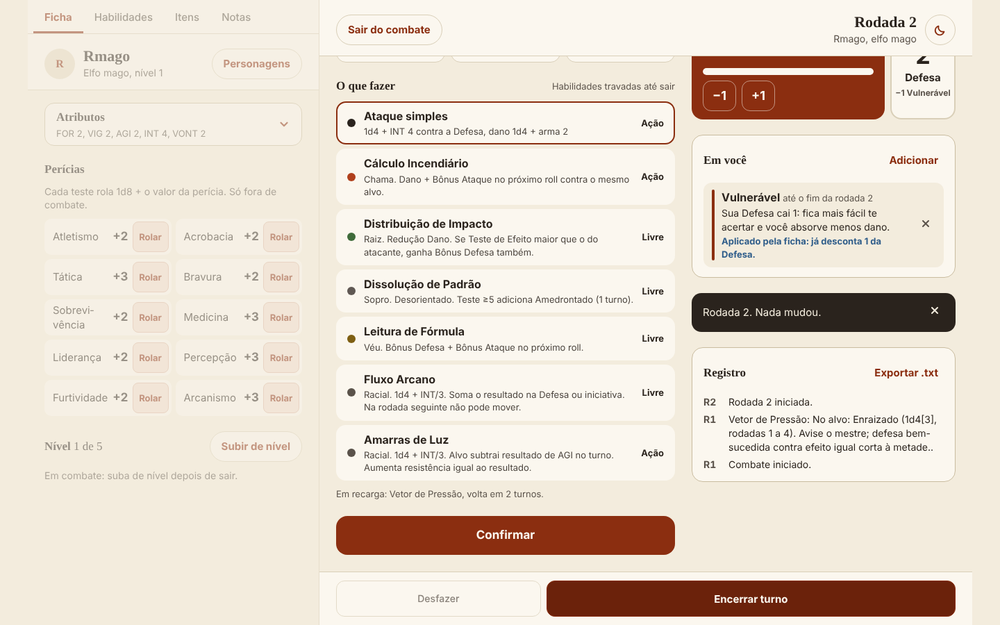
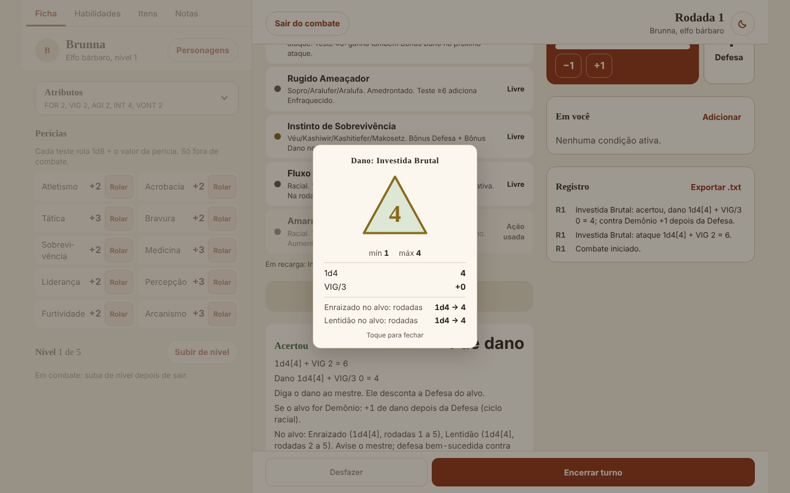

# Itolyria — Ficha D4

Ficha de personagem do RPG **Itolyria** (Sistema D4 / Mahou), em um único arquivo HTML.
Criação, ficha e combate. Roda offline no navegador; salva no `localStorage`.

**Estado:** fase 11, etapa E18 · Compêndio seguido: **v1.15** (D63–D85) · suíte com 0 falhas (13/11/2026).

| Criação | Ficha | Combate | Dado |
|---|---|---|---|
|  |  |  |  |

## Usar

Abrir `ficha_d4_fase11.html` no navegador. Sem instalação.

## Estrutura

```
ficha_d4_fase11.html      arquivo final (gerado, não editar)
fase11_src/
  shell.html              esqueleto HTML com placeholders
  estilo.css              tokens dia/noite e componentes
  dados.js                RACAS, CLASSES, MAHOU (200 habilidades), BUFFS, DEBUFFS…
  calculo.js              estado global e cálculos herdados da fase 10
  app.js                  personagem, salvamento, navegação, layout, tema
  ui-dado.js              popup central de dado (E18)
  ui-criacao.js           criação em 4 etapas, interlúdios, crônica
  ui-ficha.js             ficha: atributos, perícias, habilidades, itens, notas
  ui-combate.js           combate: rodadas, ações, condições, queda, registro
  montar_ficha.py         build: junta módulos → HTML único
  extrair_fase10.py       extrai dados.js/calculo.js da fase 10 (histórico)
  PROGRESSO.md            ledger E0–E18: rulings e resultados
  testes/                 teste_e*.py (Playwright, 390–1920 px)
docs/
  ARQUITETURA.md          módulos, build, estado, telas
  DADOS.md                estruturas de dados
  REGRAS.md               regras implementadas (Compêndio v1.15)
  TESTES.md               suíte e como rodar
  ROADMAP.md              pendências e próximos passos
  design/                 estilo visual e layout
  historico/              plano de migração para o Mahou
```

## Build

```bash
python fase11_src/montar_ficha.py            # gera ficha_d4_fase11.html
python fase11_src/montar_ficha.py saida.html # saída alternativa
```

Regra: editar só os módulos de `fase11_src/`; o HTML final é sempre gerado.

## Documentação

- [Arquitetura](docs/ARQUITETURA.md)
- [Dados](docs/DADOS.md)
- [Regras implementadas](docs/REGRAS.md)
- [Testes](docs/TESTES.md)
- [Roadmap](docs/ROADMAP.md)
- [Ledger de progresso](fase11_src/PROGRESSO.md)
